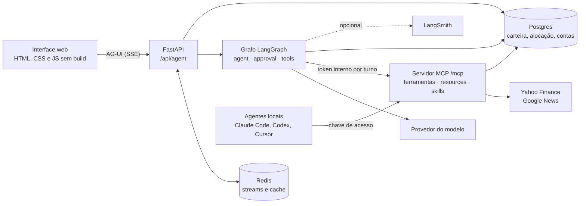

# Arquitetura

Como o Graham é montado. Cada página aprofunda uma parte; as decisões de escopo estão nos [ADRs](../adr/) e o vocabulário no [CONTEXT.md](../../CONTEXT.md).



- O agente consome as ferramentas pelo mesmo servidor MCP que agentes externos usam, com um token interno do usuário a cada turno. As ferramentas não conhecem o LangChain.
- O que grava dados para no nó `approval` até o usuário confirmar num cartão; o grafo espera no checkpoint do Postgres.
- Cada execução roda em segundo plano e grava os eventos AG-UI num Redis Stream: a conexão do navegador só lê, e pode cair e voltar.
- O Postgres guarda as conversas (uma árvore de mensagens), as memórias com embeddings (pgvector), a carteira, a alocação, as contas e os checkpoints.

| Página | O que cobre |
|---|---|
| [O agente](agente.md) | O grafo, a confirmação das operações, os checkpoints e o caminho de uma pergunta |
| [O servidor MCP](mcp.md) | Ferramentas, chaves e escopos, resources, skills (SEP-2640) e o MCP Inspector |
| [A interface e o AG-UI](interface.md) | O protocolo, os streams retomáveis, os eventos, as rotas e os cartões de ticker |
| [Carteira e dados de mercado](carteira-e-mercado.md) | Livro de operações, preço médio, alocação e rebalanceamento, e as particularidades da Yahoo |
| [A memória de longo prazo](memoria.md) | Categorias, substituição por modelo de decisão, busca híbrida e proveniência |
| [Persistência, cache e autenticação](persistencia.md) | A árvore de conversas, o cache no Redis, sessões e senhas |
| [Operação](operacao.md) | Métricas por execução, `/api/metrics` e o que acontece quando cada dependência falha |

## O código

```
main.py                      REPL de linha de comando
compose.yaml                 Postgres 18 com pgvector e Redis; no perfil app, o Graham
Dockerfile                   A imagem do Graham, que aplica as migrations ao subir
CONTEXT.md                   O vocabulário do domínio
docs/
├── FEATURES.md              O mapa das features: existentes, pendentes e fora do escopo
└── adr/                     As decisões, em especial o que ficou de fora e por quê
.github/workflows/ci.yml     Ruff e testes a cada push e pull request
db/
├── migrate.py               Aplica as migrations pendentes
└── migrations/              Schemas core, agent e langgraph, em SQL
scripts/
└── mcp_inspector.py         Abre o MCP Inspector conectado ao /mcp, com uma chave temporária
src/
├── agent/
│   ├── config/
│   │   ├── model.py         Vincula as ferramentas ao modelo
│   │   ├── settings.py      Lê as configurações e cria o modelo puro, sem ferramentas
│   │   └── settings.toml    Modelo, embedding, decisão e memória
│   ├── decision.py          Perguntas tipadas ao modelo de decisão (Jev)
│   ├── instructions/
│   │   ├── __init__.py      Carrega o prompt como SystemMessage
│   │   └── system_prompt.md Instruções do agente
│   ├── memory/
│   │   ├── embeddings.py    Embeddings pelo gateway do provedor
│   │   └── processing.py    Embedding, substituição, indexação de turnos e backfill
│   ├── runtime/
│   │   ├── context.py       O que as ferramentas recebem do servidor: usuário, pool, perfil e a conexão MCP
│   │   └── state_graph.py   O grafo, o nó de aprovação e a função que o compila
│   └── tools/
│       ├── memory.py        As ferramentas de memória, locais
│       ├── registry.py      As ferramentas do MCP e as locais, e as que pedem confirmação
│       ├── remote.py        As ferramentas do MCP vistas como ferramentas LangChain; a conexão do turno
│       ├── skills.py        O catálogo de skills do MCP no prompt e a ferramenta ler_skill
│       └── schemas/
│           └── memory.py    Schemas de entrada da memória
├── mcp_server/
│   ├── resources/           Material de referência do MCP: convenções e glossário (Markdown), fontes e catálogos
│   ├── skills/              Skills por grupo (analise, carteira); o padrão está no CLAUDE.md da pasta
│   ├── skills_extension.py  Serve as skills pela extensão SEP-2640 e como prompts
│   └── server.py            Servidor MCP: verificador de tokens e registro do catálogo
├── tools/                   As ferramentas publicadas pelo MCP, sem LangChain
│   ├── allocation.py        Classe de ativo, enquadramento e rebalanceamento
│   ├── analysis.py          Proventos (de um ativo ou da carteira), desempenho e agenda de eventos
│   ├── catalog.py           Nome, descrição, entrada, função e escopo de cada uma
│   ├── context.py           ToolContext (usuário e pool) e ToolFailure
│   ├── market.py            Cotação, notícias e buscas no yfinance e no Google News
│   ├── portfolio.py         Carteira e watchlist
│   └── schemas/             Um módulo por domínio, como as ferramentas
│       ├── allocation.py    Entrada da alocação-alvo e do rebalanceamento
│       ├── analysis.py      Entrada de proventos, desempenho e agenda
│       ├── common.py        Tipos usados por mais de um domínio (o ticker)
│       ├── market.py        Entrada e saída das ferramentas de mercado (a saída normaliza o que a Yahoo devolve)
│       └── portfolio.py     Entrada da carteira e da watchlist
├── server/
│   ├── app.py               FastAPI: subida, conversas (REST) e estáticos; monta o MCP em /mcp
│   ├── agent.py             As rotas do agente em AG-UI: executar, religar (connect) e retomar a leitura
│   ├── agui.py              O contrato AG-UI: entrada, snapshot da conversa e interrupções
│   ├── runs.py              Executa o grafo e traduz os eventos em AG-UI; cartões de ticker
│   ├── auth.py              Entrada, saída e criação de conta; a sessão de cada requisição
│   ├── keys.py              Chaves de acesso ao MCP e ao agente: criar, listar e revogar
│   ├── recorder.py          Grava as mensagens de um turno conforme o grafo as produz
│   ├── streams.py           Execuções em segundo plano, gravadas em Redis Streams retomáveis
│   └── static/
│       ├── index.html
│       ├── styles.css
│       └── js/              O cliente, em módulos ES sem build, um por parte da tela
│           ├── main.js      Liga o envio e abre a sessão
│           ├── state.js     Elementos fixos da página, a conversa aberta e a sessão
│           ├── send.js      Desenha uma execução do agente, evento por evento
│           ├── agui.js      Ids, extras do Graham e interrupções do AG-UI
│           ├── history.js   Redesenha uma conversa gravada
│           ├── approval.js  Os cartões de confirmação
│           ├── tool-runs.js O detalhe de cada consulta e a rodada de consultas
│           ├── views.js     As vistas em tabela (TOOL_VIEWS)
│           ├── chart.js     O gráfico de desempenho
│           └── ...          Conta, aba de conversas, chaves, Markdown, cartões de ticker
└── storage/
    ├── accounts.py          Contas e sessões
    ├── allocation.py        Alocação-alvo do usuário
    ├── cache.py             Cliente do Redis e cache dos dados de mercado
    ├── database.py          Pool de conexões
    ├── conversations.py     Consultas sobre threads e mensagens
    ├── history.py           Converte o caminho da thread no histórico do modelo
    ├── memories.py          Memórias: gravação, busca híbrida, substituição e esquecimento
    ├── portfolio.py         Livro de operações, preço médio e watchlist
    └── tokens.py            Tokens de acesso: chaves e tokens internos
tests/
├── conftest.py              Anula o .env antes de qualquer import
├── fakes.py                 O modelo roteirizado
├── unit/                    Regras de domínio e funções puras
├── graph/                   O grafo e a confirmação, com o modelo roteirizado
├── integration/             O servidor inteiro, contra Postgres e Redis de teste
└── evals/                   O modelo de verdade escolhendo ferramentas
```
