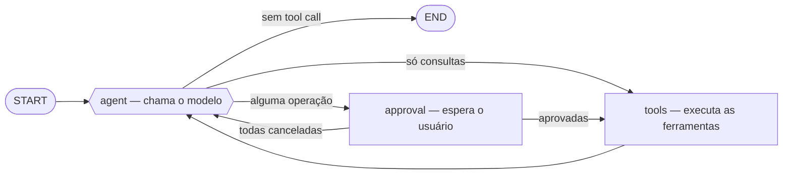
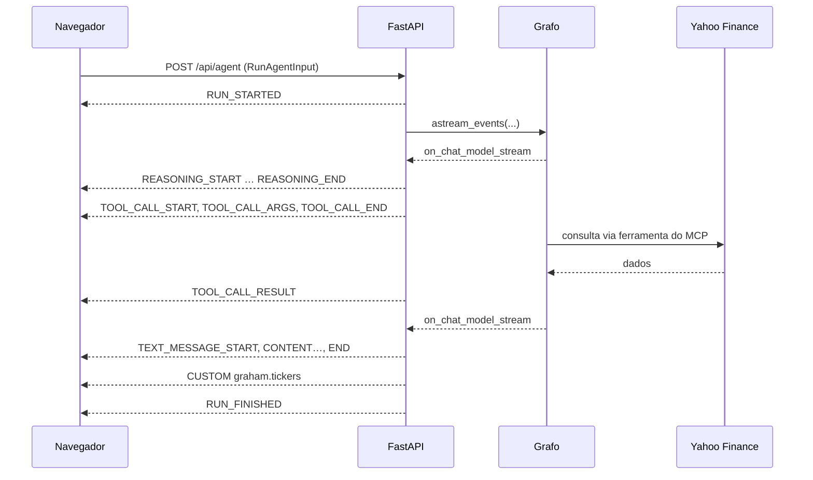

# O agente

O grafo do LangGraph, a confirmação das operações e os checkpoints.

## O grafo

Um ciclo ReAct com uma parada para confirmação, em `src/agent/runtime/state_graph.py`:

O estado é uma única chave `messages`, com o reducer `add_messages` do LangGraph cuidando de acumular o histórico. Se a última mensagem do modelo não traz `tool_calls`, o turno termina; se traz só consultas, elas rodam direto; se alguma grava dados, o grafo passa antes pelo nó `approval`.

As ferramentas recebem o usuário e o pool de conexões pelo **contexto da execução** (`AgentContext`, lido via `ToolRuntime`), que o modelo não vê e que não entra nos checkpoints. O REPL roda sem contexto, e as ferramentas de carteira respondem que só funcionam na interface web.

## Confirmação das operações

As ferramentas que gravam dados não rodam sem o usuário. Quando o modelo pede uma delas, o nó `approval` chama `interrupt()`, e o grafo para com o estado salvo no checkpoint do turno. A execução termina com uma interrupção do AG-UI por operação, e a interface mostra um cartão para cada uma, com os valores que o agente propôs em campos editáveis e os botões **Confirmar** e **Cancelar**. Quando todas as operações do passo estão decididas, as respostas vão no `resume` de uma execução nova, que as valida com o mesmo schema da ferramenta e retoma o grafo com `Command(resume=...)`.

- **A pausa fica num nó próprio, não dentro da ferramenta.** Ao retomar, o LangGraph roda de novo o nó que pausou, do começo. Num nó sem efeito colateral, repetir não muda nada; dentro de uma ferramenta, outras ferramentas do mesmo passo rodariam duas vezes.
- **Campos de lista são fechados.** A moeda do preço e a operação da watchlist aparecem como uma lista com busca (digitar "dolar" ou "USD" filtra), sem texto livre. As opções e os rótulos vêm do schema da ferramenta (`enum` e `x-labels`), o mesmo que o modelo vê e que o servidor usa para validar; a moeda só aceita as que têm câmbio na Yahoo com o dólar e com o real.
- **O ativo não se edita no cartão.** O ticker aparece fixo no cabeçalho, e o servidor ignora qualquer ticker diferente do proposto. Um ativo errado não é um valor a ajustar, e sim outra operação: o usuário cancela e pede a correção ao agente.
- **Só as aprovadas chegam às ferramentas.** O `ToolNode` executa todas as tool calls da última mensagem do modelo; por isso o nó de aprovação despacha uma tarefa por operação aprovada, via `Send`. As canceladas recebem uma resposta "o usuário cancelou", e o modelo explica.
- **A correção do usuário chega ao modelo.** O resultado da ferramenta traz `user_edits`, com o valor proposto e o aprovado. Sem isso, o modelo vê um valor diferente do que o usuário disse e conclui que errou.
- **A mensagem da pausa guarda o pedido e a decisão** (`payload.approval`), lado a lado. A mensagem do modelo fica com os valores aprovados, que são os que o histórico entrega dali em diante.
- **Uma pergunta nova no lugar da resposta ao cartão** encerra a confirmação como `interrupted`, sem fazer as operações. O AG-UI pede que ela vá junto, com as interrupções como `cancelled`; sem isso, a execução é recusada. Depois de um dia, os checkpoints do turno somem e a confirmação expira (`expiresAt` na interrupção, `RUN_ERROR` com `code: "expired"` ao responder).

## Os checkpoints

O `AsyncPostgresSaver` continua ligado, mas como **estado de execução**, não como histórico. Cada turno roda numa thread própria do LangGraph, nomeada pelo id da primeira mensagem do assistente daquele turno, e recebe o histórico já montado a partir das nossas tabelas. Os checkpoints ficam guardados por **um dia**, para inspecionar como o grafo executou, e depois uma tarefa de hora em hora os apaga.

Para ver os checkpoints de um turno, pegue o id da primeira mensagem do assistente e consulte `langgraph.checkpoints` com ele como `thread_id`. Os metadados de cada checkpoint trazem a conversa a que ele pertence, em `graham_thread_id` e em `thread_id`. O segundo é o que a LangSmith usa para agrupar os turnos de uma conversa; sem ele, o LangGraph copiaria para os metadados o `thread_id` do turno, e cada pergunta viraria uma thread à parte.

## O caminho de uma pergunta

O streaming vem de `astream_events(version="v2")`. Vale notar que **nenhum callback precisou ser registrado**: toda ferramenta LangChain já emite `on_tool_start`/`on_tool_end` por conta própria, e o `astream_events` apenas pendura um ouvinte que desce por toda a árvore de execução.

## Decisões de implementação

**Ferramentas vinculadas ao compilar o grafo.** As ferramentas do MCP só são conhecidas na subida, ao listar o servidor, então `bind_model(tools)`, em `config/model.py`, liga o modelo a elas quando o grafo é compilado, e não na importação. O resultado é um binding, não um `BaseChatModel`; quem precisa do modelo puro (o processamento de memória, por exemplo) usa `chat_model()`, de `config/settings.py`.

**Nós assíncronos são obrigatórios.** O nó `agent` usa `await model.ainvoke(...)`. Um `invoke()` síncrono roda numa thread e perde a propagação dos callbacks: os eventos `on_chat_model_stream` simplesmente não chegam, e o streaming morre silenciosamente.
