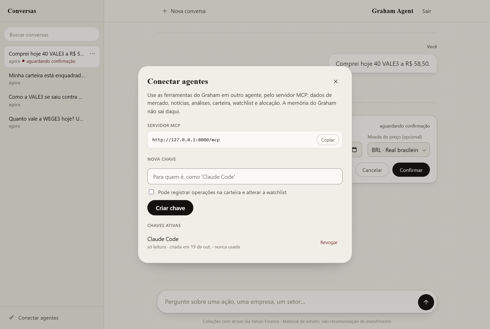

# O servidor MCP

As ferramentas, os resources e as skills que o Graham publica, para ele mesmo e para agentes locais.


*Em Conectar agentes, o usuário cria uma chave para outro agente, só de leitura ou com escrita, e a revoga quando quiser.*

## Como funciona

As ferramentas de mercado, análise, carteira e watchlist vivem num servidor [MCP](https://modelcontextprotocol.io), em `{PUBLIC_URL}/mcp` (Streamable HTTP), montado na mesma app do servidor web. O próprio Graham o consome, e outros agentes podem se conectar a ele com uma chave de acesso.

- **Chaves de acesso.** Em *Conectar agentes*, no rodapé da aba de conversas, o usuário cria uma chave com nome, vê o valor uma única vez (com um exemplo de configuração para o Claude Code) e pode revogá-la. A chave nasce só de leitura; gravar na carteira e na watchlist exige marcar a permissão ao criá-la. O agente envia `Authorization: Bearer graham_...`; o banco guarda só o SHA-256 (`core.access_tokens`).
- **Escopos.** `graham:leitura` em toda chave, `graham:escrita` nas que podem gravar. As ferramentas que gravam (`registrar_compra`, `registrar_venda`, `adicionar_watchlist`, `remover_watchlist`, `definir_alocacao` e `definir_classe_ativo`) vêm anotadas como destrutivas, para o cliente pedir a confirmação dele; sem a permissão, a chamada é recusada com uma explicação.
- **O Graham pelo MCP.** A cada turno, o servidor emite um token interno do usuário (curto, apagado no fim do turno) e abre uma conexão MCP com ele, numa tarefa própria. O cookie da sessão nunca vai ao MCP. As operações que gravam continuam passando antes pelo cartão de confirmação; as correções feitas nele são anexadas ao resultado do lado do Graham.
- **Definições na subida.** O Graham lê nome, descrição e esquema de entrada das ferramentas do próprio servidor, em processo, ao subir (o HTTP ainda não atende nesse momento), e liga o modelo a elas ao compilar o grafo.
- **O gráfico à parte.** O `desempenho` devolve as métricas no texto e a série do gráfico em `structuredContent`, que vira o artefato da mensagem: a interface desenha, o modelo não gasta tokens com ela.
- **Autorização.** Sem token, `/mcp` responde `401` com `WWW-Authenticate` apontando para os metadados do recurso protegido (RFC 9728, em `/.well-known/oauth-protected-resource/mcp`). A autenticação é só por chaves de acesso: o Graham roda na máquina do usuário e não é publicado, então conectores que exigem OAuth e acesso pela internet, como os do claude.ai e do ChatGPT, ficam de fora. Agentes locais (Claude Code, Codex, Cursor) usam as chaves.
- **Resources de referência.** Além das ferramentas, o servidor publica o que um agente precisa saber para usá-las bem: `graham://convencoes` (códigos de ativos, moedas, percentuais, datas, notas, erros e escrita), `graham://glossario` (o sentido exato de cada termo dos resultados, como é calculado), `graham://fontes` (de onde vem cada dado e por quanto tempo fica em cache, tirado das próprias constantes do código), `graham://catalogo/industrias` (os 145 subsetores aceitos) e `graham://catalogo/moedas`. Só referência, nada do usuário: a carteira já é servida pelas ferramentas, e um resource com dados pessoais tende a entrar inteiro no contexto do agente cliente. O Graham lê as convenções do próprio MCP na subida e as põe no prompt, sem a seção de escrita (nele, quem confirma é o cartão).
- **Skills.** Roteiros para tarefas recorrentes (`analisar-ativo`, `explicar-movimento`, `revisar-carteira`, `registrar-operacao`, `rebalancear-carteira`), organizados por grupo em `src/mcp_server/skills/`. Saem de três formas: pela extensão de skills do MCP ([SEP-2640](https://modelcontextprotocol.io/seps/2640-skills-extension), `skills/list` e `skills/get` com o SHA-256 de cada arquivo, em `skill://<grupo>/<nome>/SKILL.md`), que só existe na versão 2026-07-28 do protocolo; como prompts de mesmo nome, com argumentos, para os clientes que ainda não falam a extensão; e no próprio Graham, que lista nome e descrição de cada uma no prompt e carrega o roteiro com `ler_skill` quando a tarefa pede. O SDK documenta um suporte de servidor a skills que ainda não saiu (a 2.3.0 é a última publicada); até lá, os dois métodos são implementados sobre o mecanismo genérico de extensões dele. Como criar uma skill, e o padrão de variantes por argumento, está no `CLAUDE.md` da pasta.
- **A memória fica de fora.** Guardar, buscar, ver e esquecer memórias continuam ferramentas locais do Graham: a memória é dele, e expô-la deixaria outro agente ler e alterar o que ele sabe do usuário.

No REPL, sem usuário, as ferramentas MCP rodam em processo: as de mercado funcionam, e as de carteira avisam que precisam de uma conta.

## Ferramentas

As de mercado, análise, carteira, alocação e watchlist ficam no servidor MCP, que outros agentes também podem usar; as de memória são só do Graham.

| Ferramenta | Argumentos | O que retorna |
|---|---|---|
| `cotacao_atual_acao` | `ticker_name` | Preço, variação do dia, abertura, máxima/mínima, volume, valor de mercado, faixa de 52 semanas e médias móveis |
| `noticias_acao` | `ticker_name`, `count`, `tab` | Notícias recentes com título, resumo, data, veículo e link |
| `noticias_tema` | `query`, `days`, `count` | Notícias de um tema (eleições, privatizações, juros, um setor) em fontes brasileiras, pela busca do Google News |
| `buscar_ticker_por_empresa` | `company_name`, `count` | Tickers correspondentes a um nome de empresa, com bolsa, setor e indústria |
| `buscar_tickers_por_industria` | `industry`, `count`, `region` | Principais empresas de um dos 145 subsetores da classificação Yahoo |
| `ver_carteira` | `ticker_name?`, `currency?`, `include_trades?` | Posições com preço médio, total investido, valor atual e resultado, totais por moeda e resultado das vendas |
| `ver_watchlist` | `ticker_name?` | Entradas da watchlist com a cotação atual, a distância até o alvo e se ele foi atingido |
| `registrar_compra` ✋ | `ticker_name`, `quantity`, `unit_price`, `traded_on`, `currency?` | A operação gravada e a posição nova |
| `registrar_venda` ✋ | `ticker_name`, `quantity`, `unit_price`, `traded_on`, `currency?` | A operação gravada e a posição nova; recusa vender mais do que havia na data |
| `adicionar_watchlist` ✋ | `ticker_name`, `operation`, `target_price`, `quantity?` | A entrada criada |
| `remover_watchlist` ✋ | `ticker_name`, `operation`, `target_price?` | A entrada removida |
| `proventos` | `ticker_name?`, `months` | Pagamentos pela data ex, total em 12 meses, dividend yield e próxima data ex; sem ticker, quanto a carteira recebeu |
| `desempenho` | `tickers`, `period` ou `start_date`, `compare_index` | Retorno com e sem proventos, anualizado, volatilidade, maior queda, máxima e mínima, contra o Ibovespa ou o S&P 500 |
| `agenda_eventos` | `tickers?`, `days` | Próximos resultados, datas ex e pagamentos, em ordem de data; sem tickers, os da carteira e da watchlist, com a origem e a quantidade |
| `ver_enquadramento` | | Valor e peso de cada classe de ativo em reais, contra a alocação-alvo: desvio e se está dentro, acima ou abaixo da banda; e o peso de cada ativo |
| `sugerir_rebalanceamento` | `contribution`, `allow_sales` | Ordens por ativo que levariam a carteira ao alvo, usando primeiro o aporte; o que sobra e as classes sem ativo, com candidatos da watchlist. Não registra nada |
| `definir_alocacao` ✋ | `acoes_br`, `fundos`, `etfs`, `exterior`, `cripto`, `tolerance` | A alocação-alvo gravada: o peso de cada classe, somando 100%, e a banda de tolerância |
| `definir_classe_ativo` ✋ | `ticker_name`, `asset_class` | A classe em que o ativo passa a contar na alocação, no lugar da automática; `fora` o tira da conta, `automatica` desfaz a escolha |
| `guardar_memoria` | `fact`, `category` | Grava um fato duradouro sobre o usuário; embedding e substituição seguem em segundo plano |
| `buscar_memorias` | `search_fact` | Fatos e trechos de conversas anteriores relacionados, por busca híbrida |
| `ver_memoria` | `memory_id` | O conteúdo completo; numa conversa, as mensagens originais do turno |
| `esquecer_memoria` | `memory_id` | Marca a memória como esquecida, sem apagá-la |
| `ler_skill` | `name`, `file?` | O texto de uma skill do servidor MCP (um roteiro para tarefa recorrente) ou de um arquivo de apoio dela |

✋ Pede a confirmação do usuário antes de rodar (veja [Confirmação das operações](agente.md#confirmação-das-operações)).

Para adicionar uma ferramenta ao MCP, escreva a função em `src/tools/` (recebe um `ToolContext` e os argumentos), o modelo de entrada no módulo do mesmo domínio em `src/tools/schemas/` e uma entrada em `CATALOG`, em `src/tools/catalog.py`, com o nome, a descrição e o escopo (`READ` ou `WRITE`). O servidor a publica e o Graham passa a usá-la na subida seguinte; se ela gravar dados (`WRITE`), o grafo pede a confirmação do usuário antes. As de memória continuam como ferramentas LangChain, em `src/agent/tools/memory.py`.

## Inspecionar o servidor

Com o servidor no ar, o [MCP Inspector](https://github.com/modelcontextprotocol/inspector) abre já conectado ao `/mcp`, em nome de uma conta:

```bash
uv run scripts/mcp_inspector.py --email user@email.com             # interface web, só leitura
uv run scripts/mcp_inspector.py --email user@email.com --escrita   # permite as ferramentas que gravam
uv run scripts/mcp_inspector.py --email user@email.com -- --cli --method tools/list
```

O script cria uma chave temporária para a conta (só leitura, a não ser com `--escrita`), passa-a ao Inspector no cabeçalho `Authorization` e a revoga quando ele fecha; se o script cair antes, ela vence em 12 horas. Ele também pede ao Inspector a negociação automática da versão do protocolo (`--protocol-era auto`): na versão antiga, que o Inspector usaria por padrão, as skills não aparecem. Para conferir a conformidade delas com a SEP-2640: `-- --cli --method skills/list --verify`. O que vier depois de `--` vai direto ao Inspector. Precisa do Node (`npx`). Sem a chave, o Inspector tentaria o fluxo OAuth, que o servidor não oferece.
